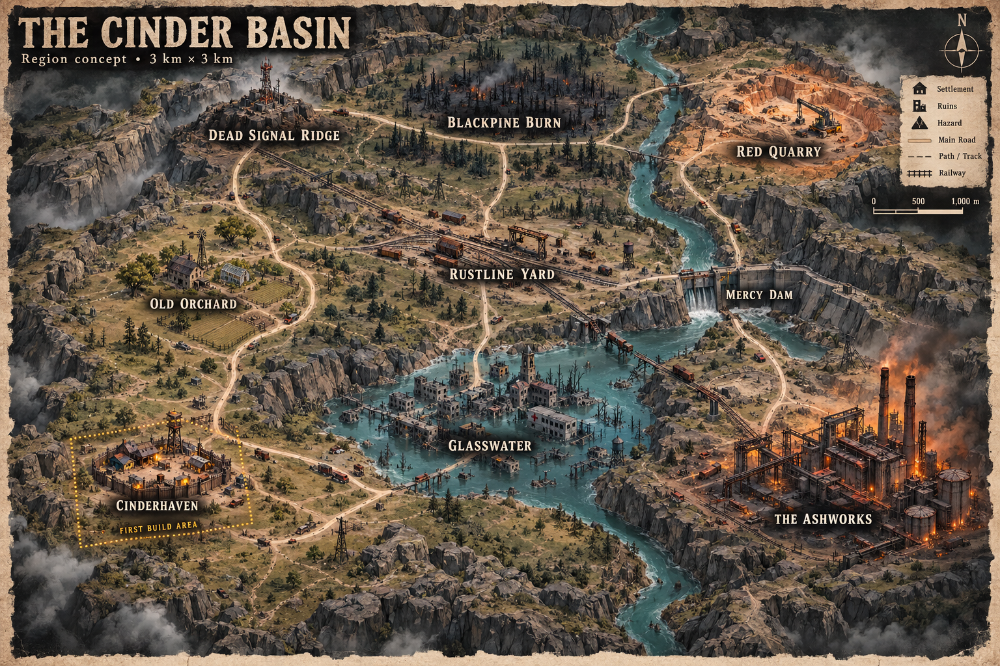

# Ashen Frontier — Cinder Basin map kit

A stylized post-apocalyptic region design for Unity: a survivor outpost, flooded town, burned forest, rail yard, quarry, dam, and abandoned ashworks.

## Download

To download everything, select **Code → Download ZIP** above the file list. Extract the download and open `Design/CinderBasin/`.

The original [map kit ZIP](ashen-frontier-region-kit.zip) is also included. On its GitHub file page, use **Download raw file** to save it.

## Start here

- [Region design and build order](Design/CinderBasin/README.md)
- [Free-first asset links and license notes](Design/CinderBasin/ASSETS.md)
- [Instructions to give Claude](Design/CinderBasin/CLAUDE_HANDOFF.md)
- [Precise map blueprint](Design/CinderBasin/region-map.png)
- [Editable SVG](Design/CinderBasin/region-map.svg)
- [Coordinates and route data](Design/CinderBasin/region-layout.json)

Begin with the **600 × 600 m Cinderhaven starter area** before expanding the full 3 × 3 km region. The documents assume Unity 6 with URP and a free-first asset budget.

This repository contains a design and handoff kit, not a playable Unity project. No third-party model packs are included. Asset downloads, Unity imports, scene assembly, and gameplay still need to be performed and validated in Unity. Read the asset license notes before adding downloaded models to a public repository.
